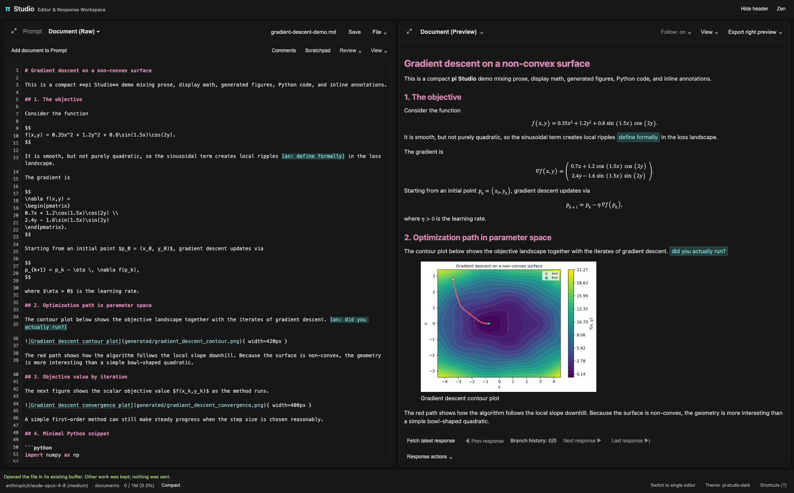
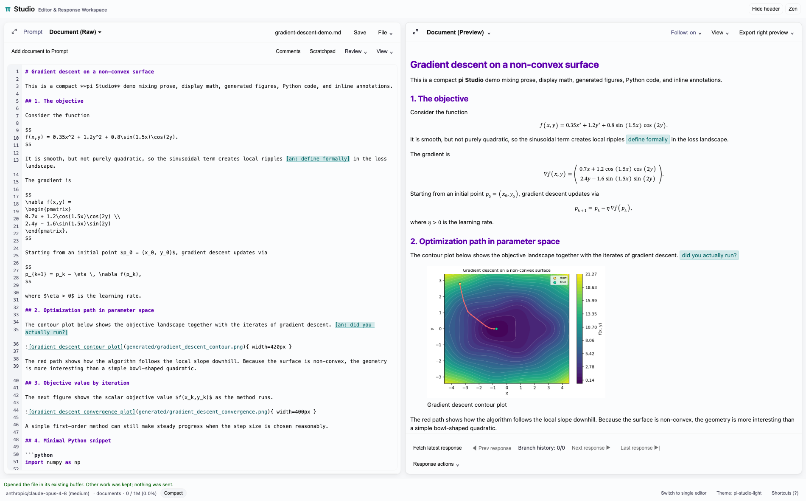
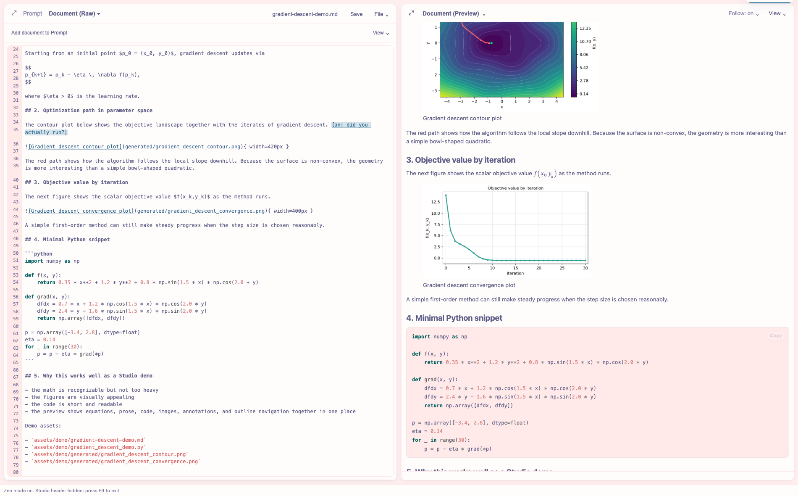
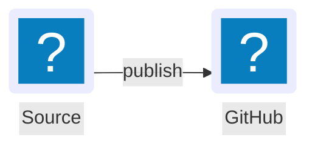

# pi-studio

A browser workspace for [Pi](https://pi.dev). Write and run prompts, read responses with rendered math and diagrams, edit and annotate documents, and follow what Pi is doing, side by side.

## Screenshots

**Dual editor mode, with the demo document open in the Document (dark and light themes):**





**Zen mode, on the code:**



There's also a [2-minute demo](https://github.com/omaclaren/pi-studio/releases/latest/download/pi-studio-demo-2min.mp4) (MP4, 2x speed, no audio) of an earlier version; the workflow is the same.

## Features

- **Prompt and Document** — the default, dual editor mode. The Prompt holds what you send to Pi; the Document holds the file you're working on. Each keeps its own edits, preview and place. See [Single and dual editor mode](#single-and-dual-editor-mode).
- **Run, critique, annotate** — run the Prompt, ask for a critique, or annotate a response with `[an: ...]` markers and send it back.
- **Response history** — step back through earlier responses, and load a response, its critique or the prompt that produced it.
- **Working** — follow Pi's thinking and tool use as it happens. **Follow activity** switches to it during a run and back to the response afterwards.
- **Rendering** — Markdown and LaTeX with math, syntax highlighting, Mermaid diagrams (with Lucide and Logos icons), CSV tables, interactive HTML and embedded PDFs, themed to match Pi.
- **Files and Changes** — browse folders you've allowed, open or preview files, and see the current git diff.
- **Comments and scratchpad** — comments anchored to lines or selections, and a scratchpad per document.
- **Side questions** — ask about the text, a folder or the repository in a separate thread that stays out of the main conversation, optionally with web search.
- **REPL** — send code to tmux-backed Shell, Python, IPython, Julia, R, GHCi or Clojure sessions, shared with [pi-repl](https://github.com/omaclaren/pi-repl).
- **Quiz me, Show me, completions** — active-recall quizzes over the text or a folder, one-turn visual explanations, and short completions at the cursor.
- **Export** — PDF (Pandoc and LaTeX) or standalone HTML, from the preview, a file or the last response.
- **Careful saving** — a save checks the file hasn't changed on disk since you opened it, and asks if it has.
- **Quarto** — preview a saved Quarto document through `quarto preview`, without running its code.
- **Layout** — side by side or stacked panes, and a Zen mode that hides everything but the text.

## Requirements

- [Pi](https://pi.dev)
- [Pandoc](https://pandoc.org/installing.html) for full previews and exports (`brew install pandoc` on macOS), and LaTeX (TeX Live or MacTeX) for PDF export
- Optional:
  - `tmux` for the REPL;
  - `quarto` for Quarto previews;
  - Mermaid CLI 11.12+ for diagrams in exported PDFs;
  - `pdftotext` so side questions can read PDFs;
  - `BRAVE_API_KEY` for side-question web search.

Studio is developed on macOS. It should work on Linux, which has had less testing.

## Install

```bash
pi install npm:pi-studio
```

Or from GitHub, `pi install https://github.com/omaclaren/pi-studio`, or once without installing, `pi -e https://github.com/omaclaren/pi-studio`.

## Usage

| Command | Description |
|---|---|
| `/studio` | Open Studio with the last response. In dual editor mode, reopen your last workspace if its tab is gone |
| `/studio <file>` | Open a text file, or a PDF in a read-only preview |
| `/studio --watch <file>` | Open a read-only preview that follows changes on disk |
| `/studio --blank`, `--last` | Start with a blank editor, or the last response |
| `/studio --single`, `--dual` | Switch editor mode, and remember it |
| `/studio --no-browser` | Print the URL without opening a browser |
| `/studio --port <port>` | Use a fixed port |
| `/studio --listen-all` | Listen on all interfaces, for containers ([see below](#network-and-ssh)) |
| `/studio --status`, `--stop` | Show the server's status, or stop it |
| `/studio-replace` | Replace the open Studio view. In dual editor mode, move it to a new tab here |
| `/studio-editor-only [file]` | Open an extra editor tab (single editor mode) |
| `/studio-current <file>` | Load a file into the open Studio tab (single editor mode) |
| `/studio-pdf [file]` | Export a file, or the last response, to PDF |
| `/studio-html [file]` | Export a file, or the last response, to HTML |

Studio opens in Muxy's or cmux's built-in browser when Pi runs there, and otherwise in the system browser. Press `?` in Studio for keyboard shortcuts.

Pi's agent can also use these tools:

| Tool | Description |
|---|---|
| `studio_export_pdf`, `studio_export_html` | Export Markdown/LaTeX, a file or the last response |
| `studio_repl_status` | List REPL sessions |
| `studio_repl_send` | Send code to a REPL and record its output |

## Single and dual editor mode

**Dual editor mode** is the default. The left pane has a **Prompt**, which is what Run sends to Pi, and a **Document**, the file you're working on. Switch with the tabs or Cmd/Ctrl+Shift+1 and 2. Selecting the Document never changes what Run sends.

- **Add to Prompt** copies the Document's selection, or all of it, into the Prompt as a labelled snapshot, with Undo.
- **File** opens a file in the Document, or in a new Document window. Each file has one editor; opening a file that's already open finds that editor.
- Unsaved Prompt and Document text survives reloads and dropped connections. If you close the tab, `/studio` reopens the same workspace, asking first if the tab didn't close cleanly. This isn't a backup: save work you want to keep.
- If Studio opened somewhere you can't find, such as another browser, `/studio-replace` moves it here, or open its URL and choose **Move it here**.
- `/studio-current`, editable `/studio-editor-only` and Office-to-Markdown conversion aren't available in dual editor mode.

**Single editor mode** is the one-editor Studio of earlier versions, where Run sends the editor's text.

To switch, use the footer button or `/studio --single` and `/studio --dual`. Studio restarts and reopens the tab, carrying over the Prompt's text, and the choice is kept for your Pi profile. The footer button waits, and says why, while there's unsaved text in the Document or a closed Document window, another Studio tab is open, or a run, save or side question is in progress. The commands work even if the page won't load; they disconnect open tabs, which keep their text, and ask before dropping anything only Studio's server holds.

## Details

### Local files

Studio reads files in the opened document's folder and in folders you allow from **Files**. A link or image elsewhere asks first, offering that file or its folder, for the rest of the session.

Embed a PDF in a Markdown preview with a `studio-pdf` block. `path` is relative to the document; the other fields are optional:

````md
```studio-pdf
path: attachments/paper.pdf
title: A title
page: 3
height: 760
watch: true
```
````

To view a PDF, run `/studio report.pdf`; it opens read-only, and `#page=N` picks the page. `/studio --watch report.pdf` also reloads it when the file changes: Studio waits for two matching file-version observations, so it doesn't read a PDF that LaTeX is still writing. This is distinct from `/studio-pdf`, which exports to a new PDF.

### Mermaid icons

Diagrams can use `lucide:*` and `logos:*` icons; the icon packs load only when a diagram uses them.

````md

````

Icons in exported PDFs need Mermaid CLI 11.12+ (`npm install -g @mermaid-js/mermaid-cli`, or set `MERMAID_CLI_PATH`).

### Pi's input editor

**Load from pi editor** (Cmd/Ctrl+Shift+L) copies the draft in Pi's terminal input into Studio, as tools like [pi-nvim-context](https://github.com/omaclaren/pi-nvim-context) build it up. When Studio runs that text, it clears the terminal draft only if the draft hasn't changed since.

### REPL

The REPL pane runs code in tmux sessions. It can start its own, and it shares a record of submissions and output with [pi-repl](https://github.com/omaclaren/pi-repl) when both use the same session. Pane echo (Off, Summary, Full) controls how much submitted code appears in the raw tmux history; Full writes your code into that history. The record format is in [`shared/REPL_SESSION_RECORD_PROTOCOL.md`](./shared/REPL_SESSION_RECORD_PROTOCOL.md).

### Side questions

**Review → Side question**, or Cmd/Ctrl+Option/Alt+Q, opens a separate thread. It starts from the selection, the section at the cursor or the whole text, and can read the document's folder, the repository or another folder you allow, including PDF, DOCX, ODT and EPUB text. Its tools are read-only. With `BRAVE_API_KEY` set, it can also search the web; queries go to Brave Search. Nothing enters the main conversation unless you choose **Bring to main conversation**.

### Network and SSH

Studio listens on `127.0.0.1` only, and every URL carries a token. Over SSH, forward the port and open the printed URL with its token; `/studio --no-browser --port <port>` gives a stable port to forward.

For a container, `/studio --no-browser --listen-all --port 4321` listens on all interfaces. Anyone with the full URL can control Studio, including running prompts and reading or writing files, and there's no TLS. Treat the URL like a password, never expose the port to the internet, and bind the host side to loopback (`-p 127.0.0.1:4321:4321`). Quarto previews use a second port, which must be forwarded too.

### Environment variables

| Variable | Effect |
|---|---|
| `PANDOC_PATH`, `PANDOC_PDF_ENGINE` | Pandoc binary, and the LaTeX engine for PDFs (default `xelatex`) |
| `MERMAID_CLI_PATH` | Mermaid CLI for diagrams in PDFs |
| `BRAVE_API_KEY` | Enables web search in side questions |
| `PI_STUDIO_FONT_MONO`, `PI_STUDIO_FONT_UI`, `PI_STUDIO_FONT_PROSE` | CSS font stacks for code, interface and previews |
| `PI_STUDIO_REPL_ECHO_MODE` | Default pane echo for `studio_repl_send`: `off`, `summary` or `full` |
| `PI_STUDIO_PANDOC_TIMEOUT_MS`, `PI_STUDIO_LATEX_TIMEOUT_MS`, `PI_STUDIO_MERMAID_TIMEOUT_MS` | Export time limits |

Installing pi-studio also adds `pi-studio-dark` and `pi-studio-light` to Pi's themes, without changing your current theme.

## Acknowledgements

Thanks to [Hal Gumbert / CampSoftware](https://github.com/campsoftware) for [Pi Studio Activity](https://campsoftware.com/blog/post.php?post=20260507-ai-ollama-pi-studio-activity), which inspired **Follow activity** and the stacked layouts.

## License

MIT
